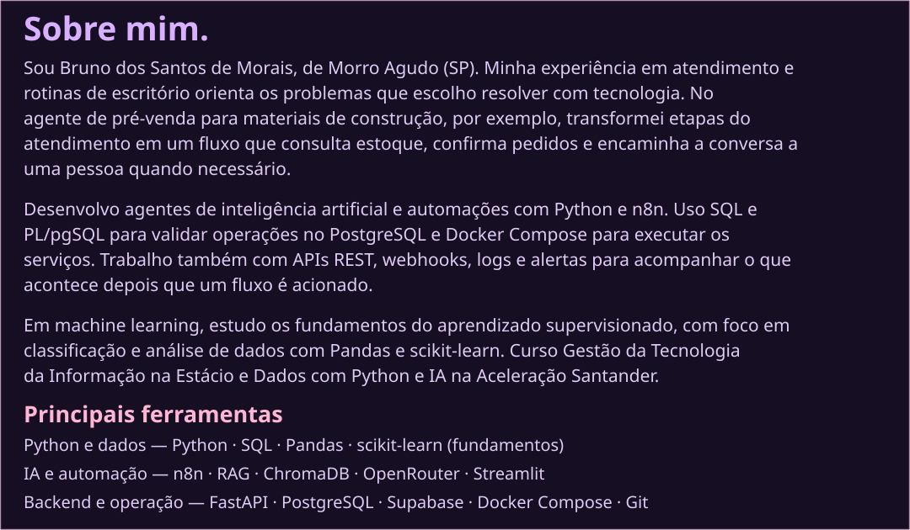
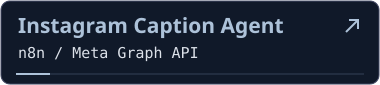

  [## Sobre mim

Sou Bruno dos Santos de Morais, de Morro Agudo (SP). Minha experiência em atendimento e rotinas de escritório orienta os problemas que escolho resolver com tecnologia. No agente de pré-venda para materiais de construção, por exemplo, transformei etapas do atendimento em um fluxo que consulta estoque, confirma pedidos e encaminha a conversa a uma pessoa quando necessário.

Desenvolvo agentes de inteligência artificial e automações com Python e n8n. Uso SQL e PL/pgSQL para validar operações no PostgreSQL e Docker Compose para executar os serviços. Trabalho também com APIs REST, webhooks, logs e alertas para acompanhar o que acontece depois que um fluxo é acionado.

Em machine learning, estudo os fundamentos do aprendizado supervisionado, com foco em classificação e análise de dados com Pandas e scikit-learn. Curso Gestão da Tecnologia da Informação na Estácio e Dados com Python e IA na Aceleração Santander.

### Principais ferramentas

- **Python e dados** — Python · SQL · Pandas · scikit-learn (fundamentos)
- **IA e automação** — n8n · RAG · ChromaDB · OpenRouter · Streamlit
- **Backend e operação** — FastAPI · PostgreSQL · Supabase · Docker Compose · Git

RAG híbrido

Desenvolvi um assistente em Python que consulta dados estruturados com Pandas e busca trechos relevantes no ChromaDB. Quando a base local não basta, o fluxo pesquisa na web com DuckDuckGo. A resposta é gerada via OpenRouter e exibida no Streamlit.

**Tecnologias:** Python · ChromaDB · Pandas · DuckDuckGo Search · OpenRouter · Streamlit

Agente de atendimento e pré-venda

O agente atende pelo WhatsApp, consulta catálogo, preços e estoque, monta e confirma pedidos. Regras transacionais no PostgreSQL validam as operações. O fluxo inclui atendimento humano, notificações por e-mail e monitoramento de falhas pela API de eventos.

**Tecnologias:** n8n · Python · PostgreSQL 16 · PL/pgSQL · Docker Compose · SMTP

Instagram Caption Agent

Automatizei a geração de legendas com IA e a publicação no Instagram pela Meta Graph API. O fluxo no n8n permite acompanhar cada execução.

**Tecnologias:** n8n · Python · Google Gemini · Meta Graph API

Mini-CRM com IA

O fluxo captura e qualifica leads, registra os contatos no PostgreSQL via Supabase e gera relatórios de acompanhamento com Python e Pandas.

**Tecnologias:** n8n · PostgreSQL · Supabase · Python · Pandas · JavaScript

[Enviar e-mail](mailto:brunosantosmo5@gmail.com) · [LinkedIn](https://www.linkedin.com/in/bruno-santos-717a761a1/) · [GitHub](https://github.com/brunosantosmo5-crypto)

## Repositórios em destaque

 

 
