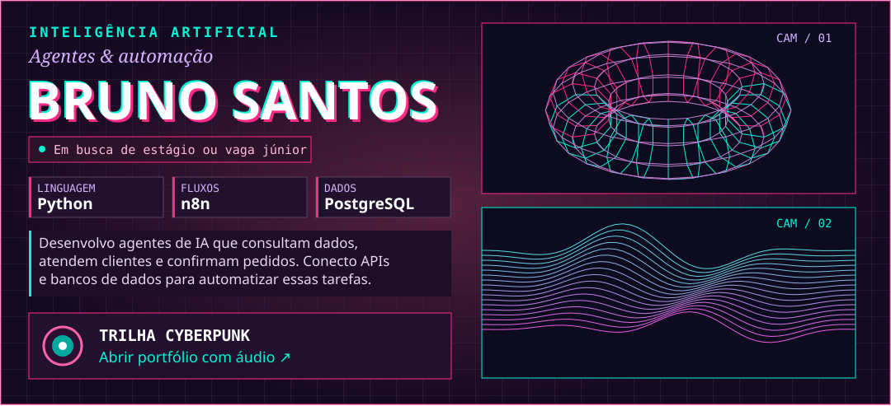
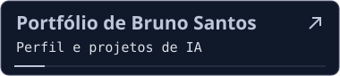

   

RAG híbrido

Consulta uma base vetorial local e recorre à busca na web quando precisa de outra fonte. A resposta chega ao usuário pela interface Streamlit.

**Tecnologias:** Python · ChromaDB · Pandas · Streamlit · OpenRouter

Agente de pré-venda

Atende pelo WhatsApp, consulta preços e estoque de materiais de construção e confirma pedidos. Regras no PostgreSQL validam os dados e o fluxo permite encaminhar a conversa a um atendente.

**Tecnologias:** n8n · PostgreSQL · Python · Docker Compose

Instagram Caption Agent

Gera legendas e publica conteúdo pela Meta Graph API, com acompanhamento de cada execução.

**Tecnologias:** n8n · Python · Meta Graph API

Mini-CRM com IA

Captura e qualifica leads, organiza os contatos e gera relatórios de acompanhamento.

**Tecnologias:** Python · Pandas · n8n · Supabase

![Sobre mim. Sou Bruno dos Santos de Morais, de Morro Agudo (SP). Minha experiência em atendimento e rotinas de escritório orienta os problemas que escolho resolver com tecnologia. No agente de pré-venda para materiais de construção, por exemplo, transformei etapas do atendimento em um fluxo que consulta estoque, confirma pedidos e encaminha a conversa a uma pessoa quando necessário. Desenvolvo agentes de inteligência artificial e automações com Python e n8n. Uso SQL e PL/pgSQL para validar operações no PostgreSQL e Docker Compose para executar os serviços. Trabalho também com APIs REST, webhooks, logs e alertas para acompanhar o que acontece depois que um fluxo é acionado. Em machine learning, estudo os fundamentos do aprendizado supervisionado, com foco em classificação e análise de dados com Pandas e scikit-learn. Curso Gestão da Tecnologia da Informação na Estácio e Dados com Python e IA na Aceleração Santander. Principais ferramentas. Python e dados — Python · SQL · Pandas · scikit-learn (fundamentos) IA e automação — n8n · RAG · ChromaDB · OpenRouter · Streamlit Backend e operação — FastAPI · PostgreSQL · Supabase · Docker Compose · Git](assets/perfil.svg)

[Enviar e-mail](mailto:brunosantosmo5@gmail.com) · [LinkedIn](https://www.linkedin.com/in/bruno-santos-717a761a1/) · [GitHub](https://github.com/brunosantosmo5-crypto)

## Repositórios em destaque

 

 
